# SmartDesk Test Cases

| Test ID | Input | Steps | Expected result | Actual result | Pass/Fail | Evidence |
| --- | --- | --- | --- | --- | --- | --- |
| TC-ValidAccess-001 | `{"subject":"Unable to access my account","description":"I cannot log into my account"}` | 1. Open the page. 2. Type the subject and description. 3. Click Submit Ticket. 4. Read the response. | `201 -> {"id","same subject","same description","category (access, billing or technical)","confidence between 0 and 1","priority","created_at"}` | `201 -> {"id": 27, "subject": "Unable to access my account", "description": "I cannot log into my account", "category": "technical", "confidence": 0.5, "priority": "normal", "created_at": "2026-10-08T15:48:59.417316+00:00"}` | Pass | 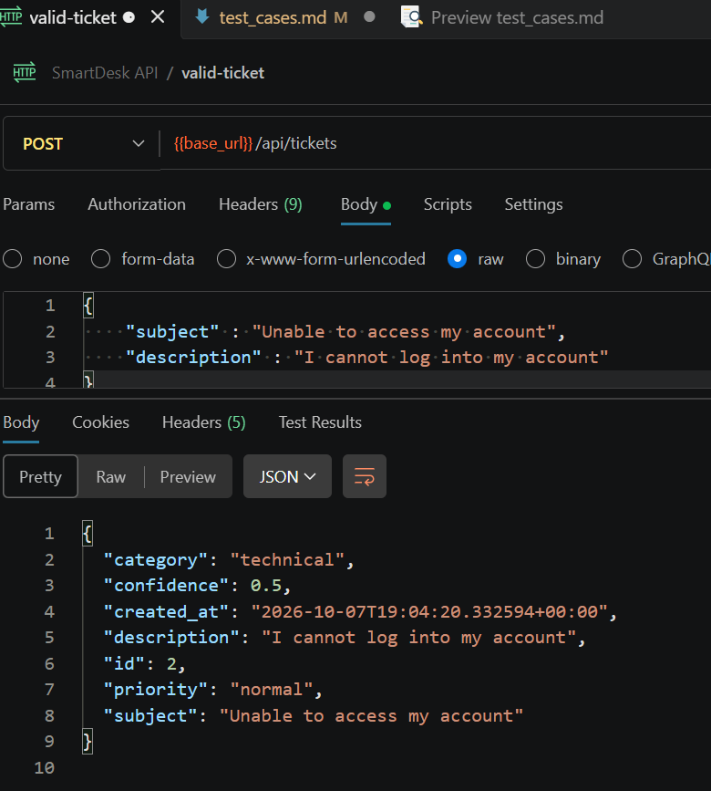 |
| TC-ValidBilling-002 | `{"subject":"Billing inquiry regarding invoice #12345","description":"I would like to request an itemized breakdown for my latest invoice."}` | 1. Open the page. 2. Type the subject and description. 3. Click Submit Ticket. 4. Read the response. | `201 -> {"id","same subject","same description","category (access, billing or technical)","confidence between 0 and 1","priority","created_at"}` | `201 -> {"id": 28, "subject": "Billing inquiry regarding invoice #12345", "description": "I would like to request an itemized breakdown for my latest invoice.", "category": "technical", "confidence": 0.5, "priority": "normal", "created_at": "2026-10-08T15:49:35.313693+00:00"}` | Pass | 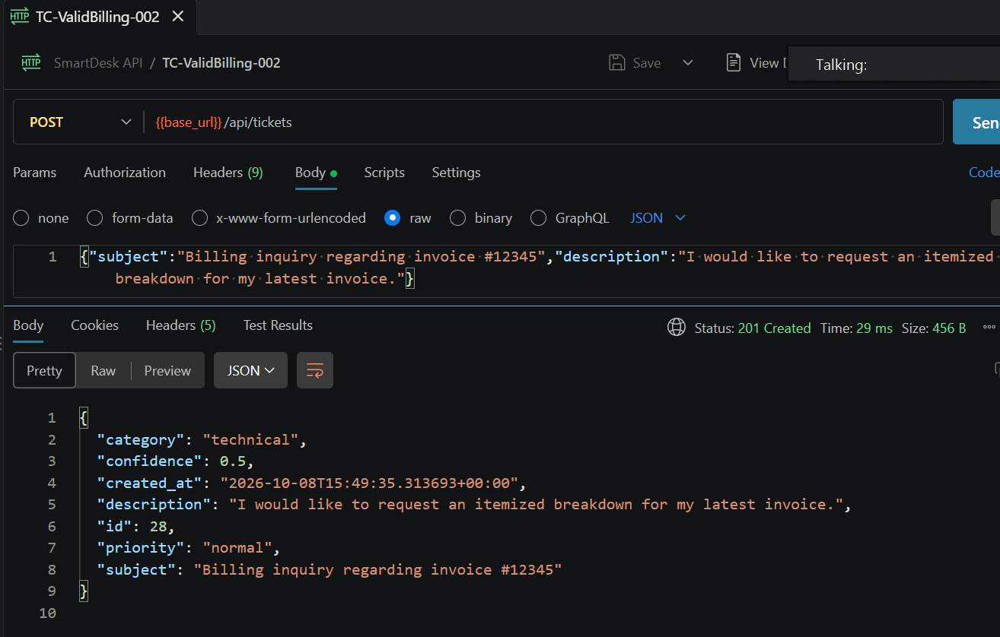 |
| TC-ValidTechnical-003 | `{"subject":"PDF upload failed","description":"The app freezes when I upload a PDF"}` | 1. Open the page. 2. Type the subject and description. 3. Click Submit Ticket. 4. Read the response. | `201 -> {"id","same subject","same description","technical","confidence","priority","created_at"}` | `201 -> {"id": 29, "subject": "PDF upload failed", "description": "The app freezes when I upload a PDF", "category": "technical", "confidence": 0.5, "priority": "normal", "created_at": "2026-10-08T15:50:43.445570+00:00"}` | Pass | 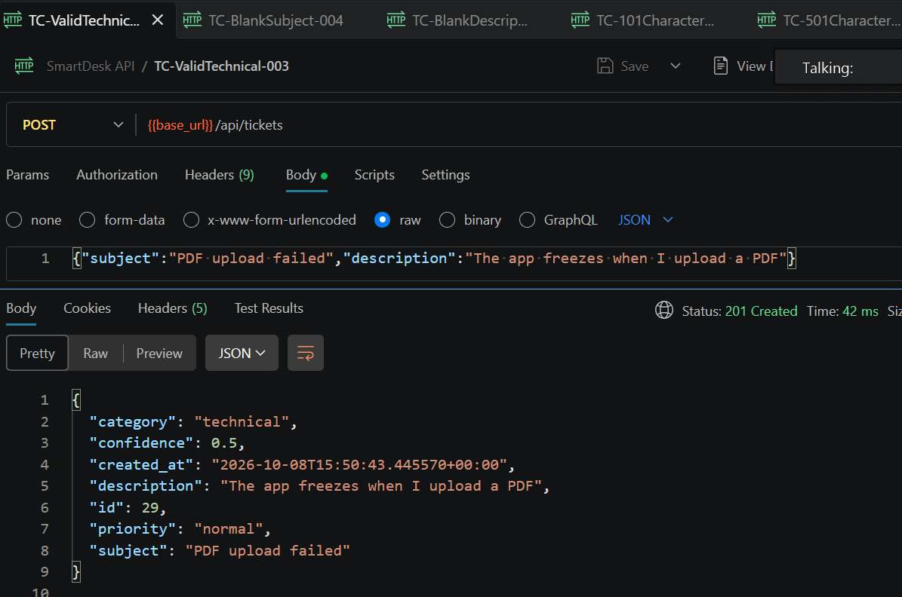 |
| TC-BlankSubject-004 | `{"subject":"","description":"Need help with my account settings"}` | 1. Send POST {{base_url}}/api/tickets with header Content-Type: application/json. 2. In Body choose raw, then JSON. 3. Send the request shown in the Input column. 4. Read the HTTP status and the response body. The request is sent through the API rather than the browser form.| `400 -> {"error":"Subject is required (max 100 characters)"}` | `400 -> {"error": "Subject is required (max 100 characters)"}` | Pass | 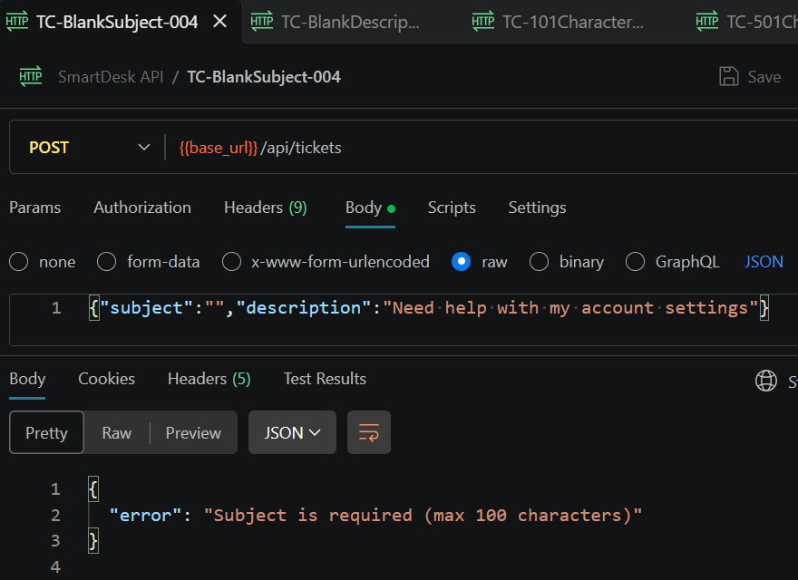 |
| TC-BlankDescription-005 | `{"subject":"Need help with my account settings","description":""}` | 1. Send POST {{base_url}}/api/tickets with header Content-Type: application/json. 2. In Body choose raw, then JSON. 3. Send the request shown in the Input column. 4. Read the HTTP status and the response body. The request is sent through the API rather than the browser form.| `400 -> {"error":"Description is required (max 500 characters)"}` | `400 -> {"error": "Description is required (max 500 characters)"}` | Pass | 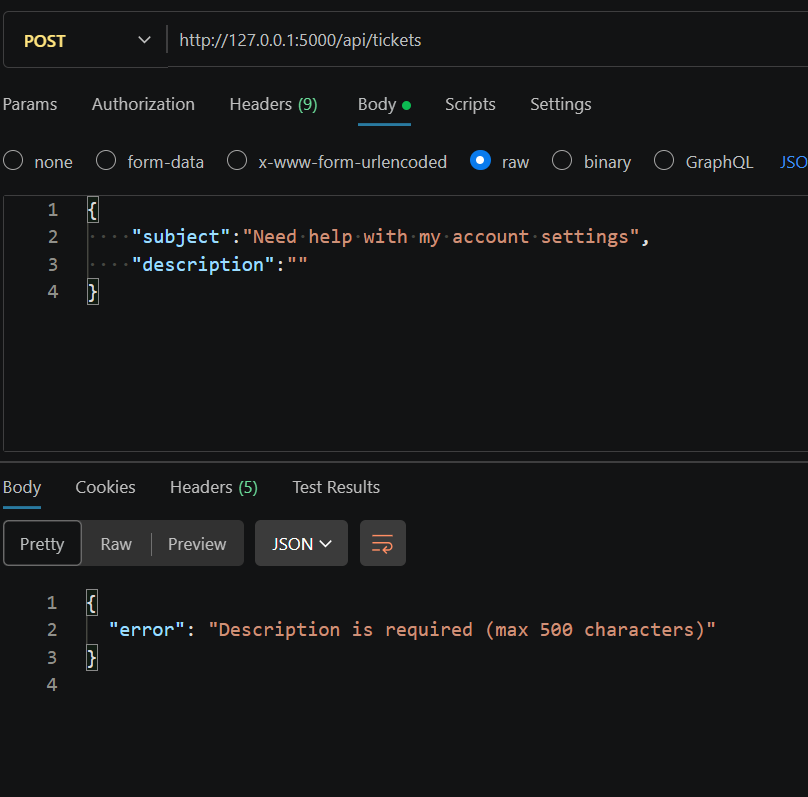 |
| TC-101CharacterSubject-006 | `subject is 101 x characters, description is "I need help logging in"` | 1. Send POST {{base_url}}/api/tickets with header Content-Type: application/json. 2. In Body choose raw, then JSON. 3. Send the request shown in the Input column. 4. Read the HTTP status and the response body. The request is sent through the API rather than the browser form. The body is generated rather than typed, because 101 characters of one letter is awkward to count by hand: `python -c "print('x' * 101)"` Then build the JSON with a real encoder so the result is valid JSON: `python -c "import json; print(json.dumps({'subject': 'x' * 101, 'description': 'I need help logging in'}))"` Paste that single line into Body, raw, JSON.| `400 -> {"error":"Subject is required (max 100 characters)"}` | `400 -> {"error": "Subject is required (max 100 characters)"}` | Pass | 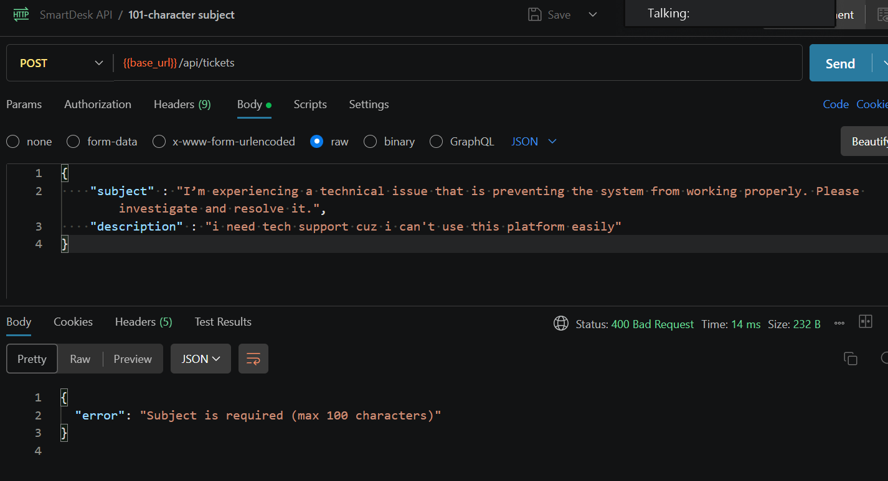 |
| TC-501CharacterDescription-007 | `subject "Technical support request", description is 501 y characters` | 1. Send POST {{base_url}}/api/tickets with header Content-Type: application/json. 2. In Body choose raw, then JSON. 3. Send the request shown in the Input column. 4. Read the HTTP status and the response body. The request is sent through the API rather than the browser form. The body is generated rather than typed, because 501 characters of one letter is awkward to count by hand: `python -c "print('y' * 501)"` Then build the JSON with a real encoder so the result is valid JSON: `python -c "import json; print(json.dumps({'subject': 'Technical support request', 'description': 'y' * 501}))"` Paste that single line into Body, raw, JSON.| `400 -> {"error":"Description is required (max 500 characters)"}` | `400 -> {"error": "Description is required (max 500 characters)"}` | Pass | 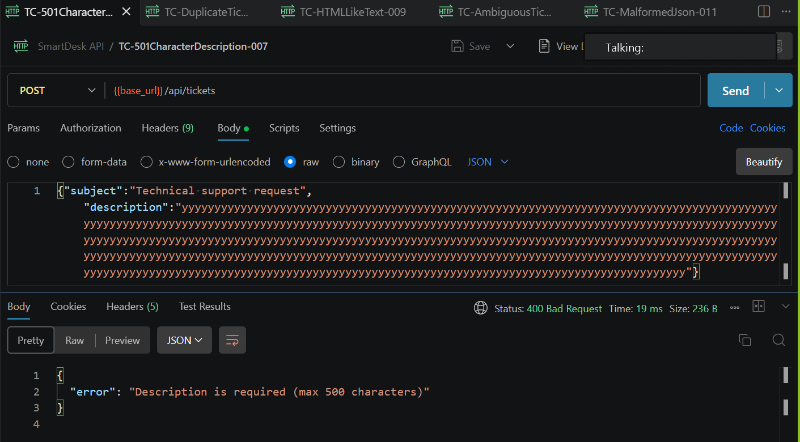 |
| TC-DuplicateTicket-008 | `{"subject":"Unable to access my account","description":"I cannot log into my account using my correct credentials."}` | 1. Send POST {{base_url}}/api/tickets with the input above. 2. Note the first status and id. 3. Send the identical request again and note the second status and id. 4. Send GET /api/tickets and read back both ids. 5. Confirm the subject and description are identical in both stored tickets. | `201 for both submissions, and the second ticket has a different id` | `Fresh rerun on 2026-10-10 at commit 757cda8: both submissions returned 201, ids 13 then 14, with identical subject and description. The linked dashboard image is from an earlier rerun in the same session and shows two cards; it does not show ids and does not evidence the statuses. The request and response file is what evidences this run.` | Pass | 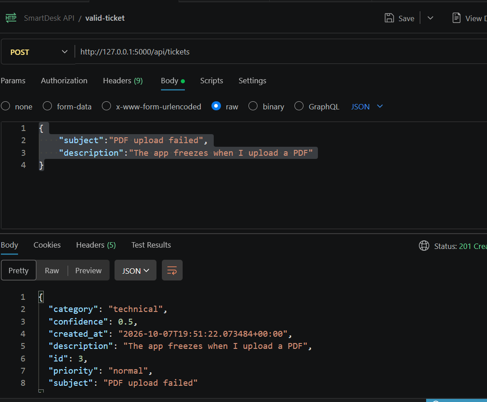 [Request and response evidence](evidences/TC-DuplicateTicket-008-evidence.md) 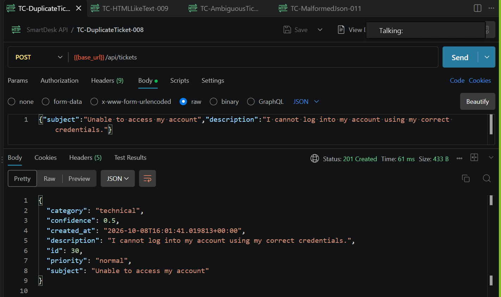 |
| TC-HTMLLikeText-009 | `{"subject":"<b>Login Problem</b>","description":"I cannot login to my account. <b>Please help.</b>"}` | Storage, via the API: 1. Send POST {{base_url}}/api/tickets with the input above. 2. Read how the tags come back in the JSON response.  Rendering, in the browser: 3. Open the page, submit the same text, then reload with F5. 4. Observe whether the card shows bold text or the literal tags.  The API result and the browser observation are recorded separately. | `201 -> {"id","subject stored unchanged","description stored unchanged","category","confidence","priority","created_at"}` | `Storage -> 201 -> {"id": 31, "subject": "<b>Login Problem</b>", "description": "I cannot login to my account. <b>Please help.</b>", "category": "technical", "confidence": 0.5, "priority": "normal", "created_at": "2026-10-08T16:02:08.094161+00:00"}. The JSON response returns the tags literally. Rendering, observed separately in Chrome on 2026-10-10 after a reload: the card showed the literal text <b>Login Problem</b> and <b>Please help.</b> rather than bold text, and the page HTML contained &lt;b&gt; instead of a b element. That is the whole of the observation for this case: it says nothing about script or image handling, which the Task 2934 rows below cover with their own evidence.` | Pass | 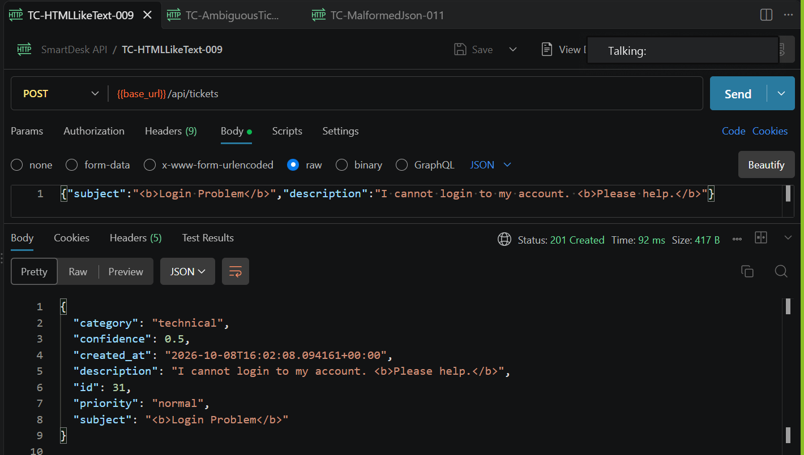 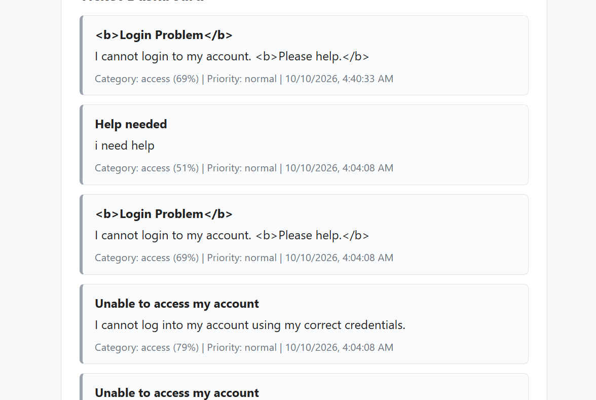 |
| TC-AmbiguousTicket-010 | `{"subject":"Help needed","description":"i need help"}` | 1. Open the page. 2. Type the subject and description. 3. Click Submit Ticket. 4. Read the response. | `201 -> {"id","same subject","same description","one valid category (access, billing or technical)","confidence between 0 and 1","priority","created_at"}` | `201 -> {"id": 32, "subject": "Help needed", "description": "i need help", "category": "technical", "confidence": 0.5, "priority": "normal", "created_at": "2026-10-08T16:02:33.623465+00:00"}` | Pass | 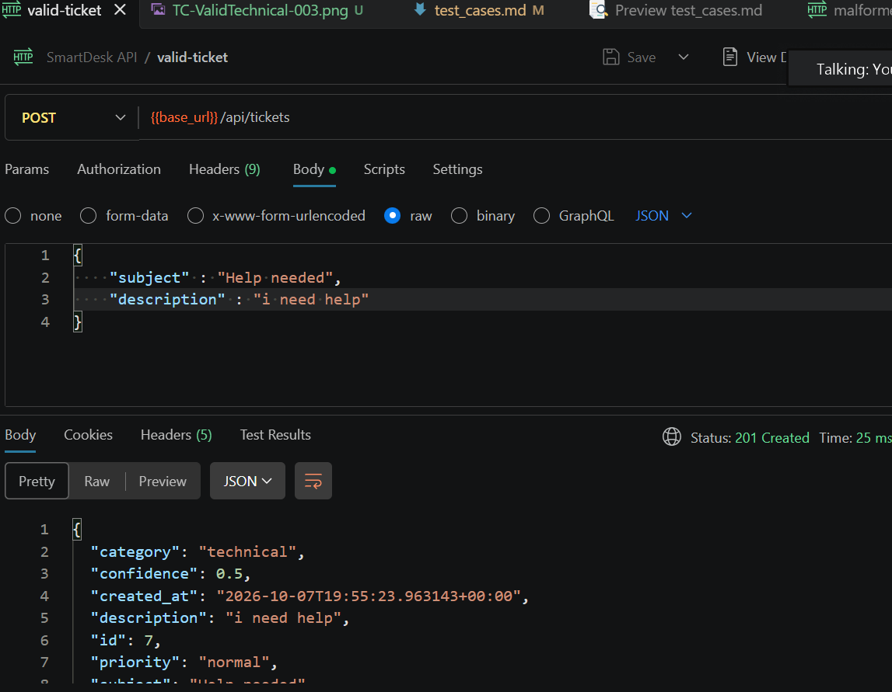 |
| TC-MalformedJson-011 | `{"subject":"Help needed","description":}` | 1. Send POST {{base_url}}/api/tickets with header Content-Type: application/json. 2. In Body choose raw, then JSON. 3. Paste {"subject":"Help needed","description":} exactly, with no value after the last colon. 4. Send and read the status and body. | `400 -> {"error":"Request body must be a JSON object"}` | `400 -> {"error": "Request body must be a JSON object"}` | Pass | 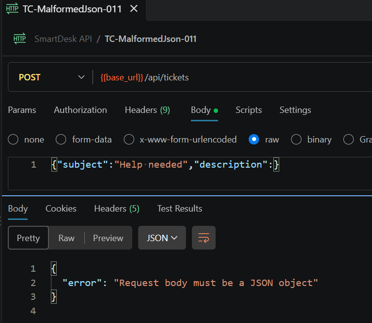 |
| TC-Priority-012 | `{"subject":"Login broken","description":"I cannot access my account"}` | 1. Open the page. 2. Type the subject and description. 3. Click Submit. 4. Read the priority on the new card. | `201 -> priority urgent` | `201 -> {"id": 33, "priority": "urgent", "category": "access", "confidence": 0.737}` | Pass | 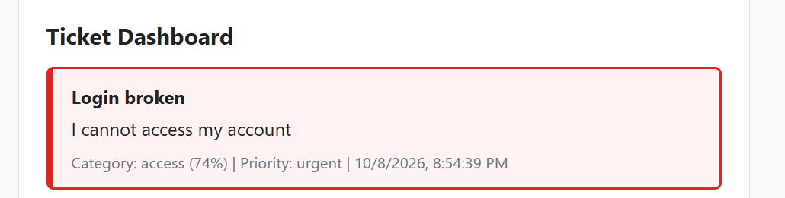 |
| TC-Priority-013 | `{"subject":"Server DOWN","description":"Site unreachable"}` | 1. Open the page. 2. Type the subject and description. 3. Click Submit. 4. Read the priority on the new card. | `201 -> priority urgent (capital letters)` | `201 -> {"id": 34, "priority": "urgent", "category": "technical", "confidence": 0.477}` | Pass | 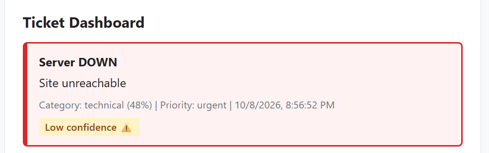 |
| TC-Priority-014 | `{"subject":"Download fails","description":"The download button gives an error"}` | 1. Open the page. 2. Type the subject and description. 3. Click Submit. 4. Read the priority on the new card. | `201 -> priority normal (download is not the word down)` | `201 -> {"id": 35, "priority": "normal", "category": "technical", "confidence": 0.778}` | Pass | 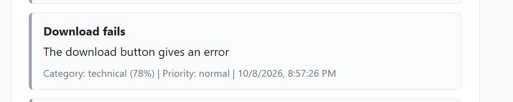 |
| TC-Priority-015 | `{"subject":"Printer issue","description":"Paper jam on floor 2"}` | 1. Open the page. 2. Type the subject and description. 3. Click Submit. 4. Read the priority on the new card. | `201 -> priority normal` | `201 -> {"id": 36, "priority": "normal", "category": "billing", "confidence": 0.445}` | Pass | 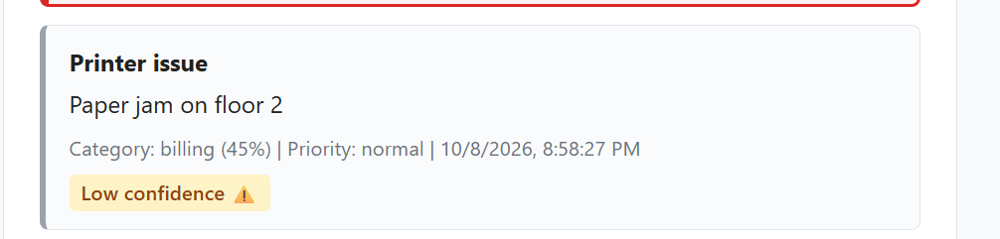 |
| TC-Priority-016 | `{"subject":"Outage","description":"Please help"}` | 1. Open the page. 2. Type the subject and description. 3. Click Submit. 4. Read the priority on the new card. | `201 -> priority urgent (phrase in subject only)` | `201 -> {"id": 37, "priority": "urgent", "category": "access", "confidence": 0.481}` | Pass | 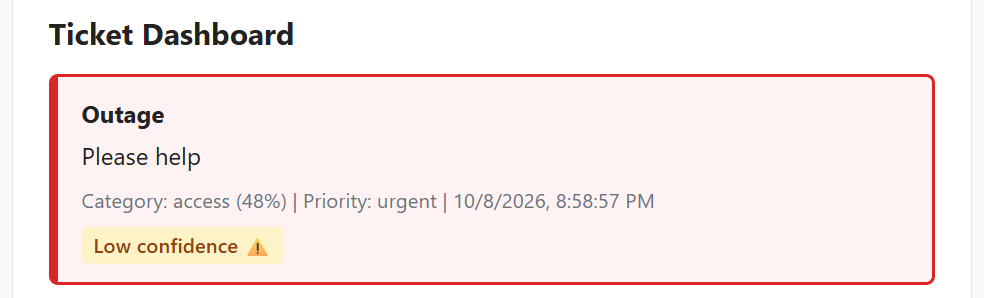 |
| TC-Priority-017 | `{"subject":"Report problem","description":"We had data loss after saving"}` | 1. Open the page. 2. Type the subject and description. 3. Click Submit. 4. Read the priority on the new card. | `201 -> priority urgent (phrase in description only)` | `201 -> {"id": 38, "priority": "urgent", "category": "technical", "confidence": 0.491}` | Pass | 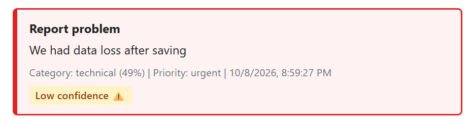 |
| TC-Priority-018 | `{"subject":"Password reset","description":"I am locked out since this morning"}` | 1. Open the page. 2. Type the subject and description. 3. Click Submit. 4. Read the priority on the new card. | `201 -> priority urgent` | `201 -> {"id": 39, "priority": "urgent", "category": "access", "confidence": 0.619}` | Pass | 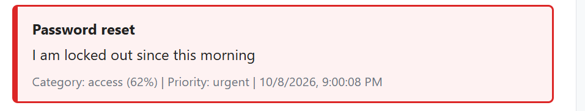 |
| TC-Priority-019 | `{"subject":"Slow laptop","description":"Everything is slow after the breakdown of my laptop"}` | 1. Open the page. 2. Type the subject and description. 3. Click Submit. 4. Read the priority on the new card. | `201 -> priority normal (breakdown is not the word down)` | `201 -> {"id": 40, "priority": "normal", "category": "access", "confidence": 0.528}` | Pass | 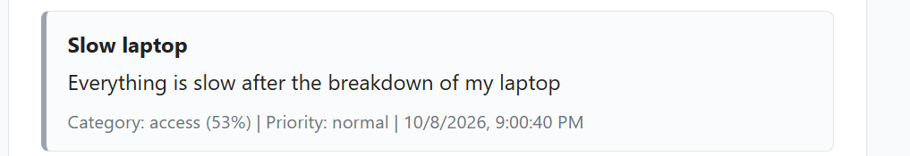 |
| TC-Priority-020 | `{"subject":"Cannot log in","description":"I can't access my account"}` | 1. Open the page. 2. Type the subject and description. 3. Click Submit. 4. Read the priority on the new card. | `201 -> priority normal (the rule only matches the words cannot access)` | `201 -> {"id": 41, "priority": "normal", "category": "access", "confidence": 0.813}` | Pass | 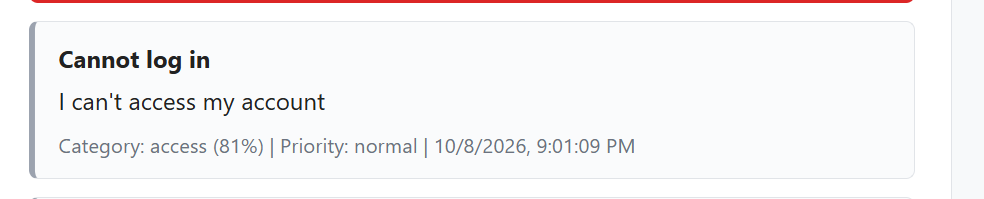 |
| TC-Priority-021 | Submit TC-Priority-013 (urgent) first, then TC-Priority-015 (normal), then reload the page and send GET /api/tickets | 1. Submit the urgent ticket. 2. Submit the normal ticket afterwards. 3. Reload the dashboard and send GET /api/tickets. 4. Compare the positions of the two tickets. | `The older urgent ticket appears above the newer normal ticket` | `201 -> urgent ticket created with id 1, priority urgent. 201 -> normal ticket created afterwards with id 2, priority normal. 200 -> GET /api/tickets returns 2 cards; the older urgent card id 1 "Server DOWN" is at position 0 and the newer normal card id 2 "Printer issue" is at position 1, so the older urgent ticket stays above the newer normal one. The dashboard was emptied first so only these two cards are visible.` | Pass | 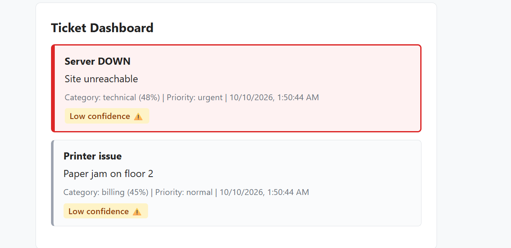 |
| TC-Priority-022 | `{"subject":"Login issue","description":"This affects all users"}` | 1. Open the page. 2. Type the subject and description. 3. Click Submit. 4. Read the priority on the new card. | `201 -> priority urgent (phrase in description only)` | `201 -> {"id": 56, "priority": "urgent", "category": "access", "confidence": 0.378}` | Pass | 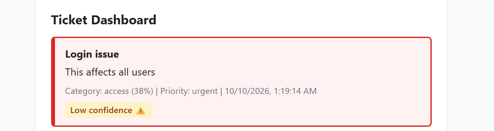 |
| TC-Priority-023 | `{"subject":"Login issue","description":"Everyone is affected"}` | 1. Open the page. 2. Type the subject and description. 3. Click Submit. 4. Read the priority on the new card. | `201 -> priority urgent (phrase in description only)` | `201 -> {"id": 57, "priority": "urgent", "category": "access", "confidence": 0.429}` | Pass | 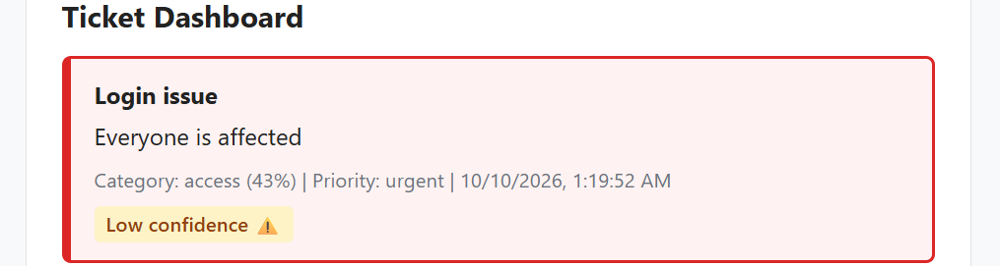 |
| TC-Priority-024 | `{"subject":"Production issue","description":"Please investigate"}` | 1. Open the page. 2. Type the subject and description. 3. Click Submit. 4. Read the priority on the new card. | `201 -> priority urgent (phrase in subject only)` | `201 -> {"id": 58, "priority": "urgent", "category": "billing", "confidence": 0.493}` | Pass | 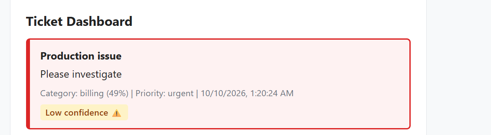 |

## How each result was produced

Three sessions. Nothing was reconstructed from memory and no observed value was
adjusted to make a row pass.

- Main table, API rows other than TC-DuplicateTicket-008: recorded on 2026-10-08 against the
  temporary stub predictor, which returned technical with confidence 0.5 for every ticket. The ids
  27 to 32 are the ones visible in the screenshots linked from those rows, so those rows and their
  evidence match each other. They are the historical record for task 2915 and are not evidence about
  the trained model.
- Main table, TC-DuplicateTicket-008: not historical. It is a fresh rerun on 2026-10-10 at commit
  757cda8 against the trained model, with both 201 statuses and ids 13 then 14. Its request and
  response evidence is a separate file; the dashboard image beside it is from an earlier rerun in the
  same session.
- Current-model API rerun table: a fresh run on 2026-10-11 at commit 04dcb2c, ids 22 to 28, with
  full requests, statuses and responses in its own evidence file.
- Priority rows TC-Priority-012 to 024: recorded against the trained model on 2026-10-08, ids 33 to 41 and
  56 to 58, except TC-Priority-021.
- TC-Priority-021: rerun on 2026-10-10 at commit 936cd04 after clearing the local database, so it shows only
  the two tickets under test, urgent id 1 above newer normal id 2. Its evidence is
  tests/evidences/TC-Priority-021.png.
- An earlier rerun at commit a07ed14 on 2026-10-10 produced real results but was recorded only as
  abbreviated text with no saved request or response evidence, so it could not be verified. Its
  table has been replaced by the 2026-10-11 run above rather than kept, because keeping
  unevidenced numbers next to evidenced ones invites confusion. Nothing in it was reused: the
  2026-10-11 values come from a new run.

Two different things should not be confused. Every API row satisfied its API contract in every
session: valid rows returned 201 with the subject and description echoed back unchanged, and invalid
rows returned 400 with the documented message. Separately, the category expectation on
TC-ValidAccess-001 and TC-ValidBilling-002 did not match what the stub returned, because the stub
returned technical for everything. With the trained model those two rows return access and billing, so
the category expectation was correct all along and the stub was the cause of the earlier failures.

## Current-model API rerun

Run at commit 04dcb2ce188cce5fc027d871ac86de1b231208f1 on 2026-10-11, after
`python ai/train.py` and `python backend/app.py`. The full requests, HTTP statuses
and full responses are in [API current-model evidence](evidences/API-current-model-evidence.md).
The rows below are a summary of that file, not excerpts of it.

| Test ID | Expected | Result | Evidence |
| --- | --- | --- | --- |
| TC-ValidAccess-001 | 201, subject and description unchanged, category one of the three, confidence 0 to 1, priority and created_at present | 201, id 22, subject and description unchanged, category access, confidence 0.768, priority normal, created_at 2026-10-10T21:02:39.140407+00:00 | [API evidence](evidences/API-current-model-evidence.md) |
| TC-ValidBilling-002 | 201, unchanged, valid category, confidence 0 to 1, priority and created_at present | 201, id 23, unchanged, category billing, confidence 0.642, priority normal, created_at 2026-10-10T21:02:39.156060+00:00 | [API evidence](evidences/API-current-model-evidence.md) |
| TC-ValidTechnical-003 | 201, unchanged, technical, priority and created_at present | 201, id 24, unchanged, category technical, confidence 0.661, priority normal, created_at 2026-10-10T21:02:39.169160+00:00 | [API evidence](evidences/API-current-model-evidence.md) |
| TC-BlankSubject-004 | 400 Subject is required | 400, Subject is required (max 100 characters) | [API evidence](evidences/API-current-model-evidence.md) |
| TC-BlankDescription-005 | 400 Description is required | 400, Description is required (max 500 characters) | [API evidence](evidences/API-current-model-evidence.md) |
| TC-101CharacterSubject-006 | 400 Subject is required | 400, Subject is required (max 100 characters) | [API evidence](evidences/API-current-model-evidence.md) |
| TC-501CharacterDescription-007 | 400 Description is required | 400, Description is required (max 500 characters) | [API evidence](evidences/API-current-model-evidence.md) |
| TC-DuplicateTicket-008 | 201 for both, different ids | 201 then 201, id 25 then 26, identical subject and description | [API evidence](evidences/API-current-model-evidence.md) |
| TC-HTMLLikeText-009 | 201, subject and description stored unchanged | 201, id 27, both stored with the tags literal, category access, confidence 0.69 | [API evidence](evidences/API-current-model-evidence.md) |
| TC-AmbiguousTicket-010 | 201, unchanged, one valid category, confidence 0 to 1 | 201, id 28, unchanged, category access, confidence 0.51, priority normal | [API evidence](evidences/API-current-model-evidence.md) |
| TC-MalformedJson-011 | 400 Request body must be a JSON object | 400, Request body must be a JSON object | [API evidence](evidences/API-current-model-evidence.md) |

Browser rendering is not covered by that file. The rendering observation for
TC-HTMLLikeText-009 has its own screenshot.

## Model quality, reported separately

Model accuracy is not a pass or fail condition for any row here.

docs/model_evaluation.md reports two numbers and they are not interchangeable. 0.625 is the accuracy on
the 20% test split, which contains only 8 tickets, so a single wrong prediction moves it by 12.5 points.
0.632 (+/- 0.198) is the 5-fold cross-validation mean, and that report names it the more reliable figure.
Neither is a pass or fail condition for these rows.

The model also mislabels some tickets. TC-Priority-015 was classified billing for a printer problem.
That is a quality observation for the model owners, not an API bug.

## Known gaps

- The current-model API rerun is evidenced as requests, statuses and full responses in
  tests/evidences/API-current-model-evidence.md, but there is no Postman screenshot for each of those
  eleven cases. The main table rows still point at the 2026-10-08 stub screenshots, which match their
  own Actual values but are not evidence about the trained model.
- TC-DuplicateTicket-008 has a dashboard image from an earlier rerun in the same session. The ids and
  statuses come from its request and response file, not from that image.

## Task 2934 - Unsafe and unusual input
# SmartDesk test cases

| Test ID | Input | Steps | Expected result | Actual result | Pass/Fail | Evidence |
| --- | --- | --- | --- | --- | --- | --- |
| TC-ValidAccess-001 | `{"subject":"Unable to access my account","description":"I cannot log into my account"}` | 1. Open the page. 2. Type the subject and description. 3. Click Submit Ticket. 4. Read the response. | `201 -> {"id","same subject","same description","category (access, billing or technical)","confidence between 0 and 1","priority","created_at"}` | `201 -> {"id": 27, "subject": "Unable to access my account", "description": "I cannot log into my account", "category": "technical", "confidence": 0.5, "priority": "normal", "created_at": "2026-10-08T15:48:59.417316+00:00"}` | Pass |  |
| TC-ValidBilling-002 | `{"subject":"Billing inquiry regarding invoice #12345","description":"I would like to request an itemized breakdown for my latest invoice."}` | 1. Open the page. 2. Type the subject and description. 3. Click Submit Ticket. 4. Read the response. | `201 -> {"id","same subject","same description","category (access, billing or technical)","confidence between 0 and 1","priority","created_at"}` | `201 -> {"id": 28, "subject": "Billing inquiry regarding invoice #12345", "description": "I would like to request an itemized breakdown for my latest invoice.", "category": "technical", "confidence": 0.5, "priority": "normal", "created_at": "2026-10-08T15:49:35.313693+00:00"}` | Pass |  |
| TC-ValidTechnical-003 | `{"subject":"PDF upload failed","description":"The app freezes when I upload a PDF"}` | 1. Open the page. 2. Type the subject and description. 3. Click Submit Ticket. 4. Read the response. | `201 -> {"id","same subject","same description","technical","confidence","priority","created_at"}` | `201 -> {"id": 29, "subject": "PDF upload failed", "description": "The app freezes when I upload a PDF", "category": "technical", "confidence": 0.5, "priority": "normal", "created_at": "2026-10-08T15:50:43.445570+00:00"}` | Pass |  |
| TC-BlankSubject-004 | `{"subject":"","description":"Need help with my account settings"}` | 1. Send POST {{base_url}}/api/tickets with header Content-Type: application/json. 2. In Body choose raw, then JSON. 3. Send the request shown in the Input column. 4. Read the HTTP status and the response body. The request is sent through the API rather than the browser form.| `400 -> {"error":"Subject is required (max 100 characters)"}` | `400 -> {"error": "Subject is required (max 100 characters)"}` | Pass |  |
| TC-BlankDescription-005 | `{"subject":"Need help with my account settings","description":""}` | 1. Send POST {{base_url}}/api/tickets with header Content-Type: application/json. 2. In Body choose raw, then JSON. 3. Send the request shown in the Input column. 4. Read the HTTP status and the response body. The request is sent through the API rather than the browser form.| `400 -> {"error":"Description is required (max 500 characters)"}` | `400 -> {"error": "Description is required (max 500 characters)"}` | Pass |  |
| TC-101CharacterSubject-006 | `subject is 101 x characters, description is "I need help logging in"` | 1. Send POST {{base_url}}/api/tickets with header Content-Type: application/json. 2. In Body choose raw, then JSON. 3. Send the request shown in the Input column. 4. Read the HTTP status and the response body. The request is sent through the API rather than the browser form. The body is generated rather than typed, because 101 characters of one letter is awkward to count by hand: `python -c "print('x' * 101)"` Then build the JSON with a real encoder so the result is valid JSON: `python -c "import json; print(json.dumps({'subject': 'x' * 101, 'description': 'I need help logging in'}))"` Paste that single line into Body, raw, JSON.| `400 -> {"error":"Subject is required (max 100 characters)"}` | `400 -> {"error": "Subject is required (max 100 characters)"}` | Pass |  |
| TC-501CharacterDescription-007 | `subject "Technical support request", description is 501 y characters` | 1. Send POST {{base_url}}/api/tickets with header Content-Type: application/json. 2. In Body choose raw, then JSON. 3. Send the request shown in the Input column. 4. Read the HTTP status and the response body. The request is sent through the API rather than the browser form. The body is generated rather than typed, because 501 characters of one letter is awkward to count by hand: `python -c "print('y' * 501)"` Then build the JSON with a real encoder so the result is valid JSON: `python -c "import json; print(json.dumps({'subject': 'Technical support request', 'description': 'y' * 501}))"` Paste that single line into Body, raw, JSON.| `400 -> {"error":"Description is required (max 500 characters)"}` | `400 -> {"error": "Description is required (max 500 characters)"}` | Pass |  |
| TC-DuplicateTicket-008 | `{"subject":"Unable to access my account","description":"I cannot log into my account using my correct credentials."}` | 1. Send POST {{base_url}}/api/tickets with the input above. 2. Note the first status and id. 3. Send the identical request again and note the second status and id. 4. Send GET /api/tickets and read back both ids. 5. Confirm the subject and description are identical in both stored tickets. | `201 for both submissions, and the second ticket has a different id` | `Fresh rerun on 2026-10-10 at commit 757cda8: both submissions returned 201, ids 13 then 14, with identical subject and description. The linked dashboard image is from an earlier rerun in the same session and shows two cards; it does not show ids and does not evidence the statuses. The request and response file is what evidences this run.` | Pass |  [Request and response evidence](evidences/TC-DuplicateTicket-008-evidence.md)  |
| TC-HTMLLikeText-009 | `{"subject":"<b>Login Problem</b>","description":"I cannot login to my account. <b>Please help.</b>"}` | Storage, via the API: 1. Send POST {{base_url}}/api/tickets with the input above. 2. Read how the tags come back in the JSON response.  Rendering, in the browser: 3. Open the page, submit the same text, then reload with F5. 4. Observe whether the card shows bold text or the literal tags.  The API result and the browser observation are recorded separately. | `201 -> {"id","subject stored unchanged","description stored unchanged","category","confidence","priority","created_at"}` | `Storage -> 201 -> {"id": 31, "subject": "<b>Login Problem</b>", "description": "I cannot login to my account. <b>Please help.</b>", "category": "technical", "confidence": 0.5, "priority": "normal", "created_at": "2026-10-08T16:02:08.094161+00:00"}. The JSON response returns the tags literally. Rendering, observed separately in Chrome on 2026-10-10 after a reload: the card showed the literal text <b>Login Problem</b> and <b>Please help.</b> rather than bold text, and the page HTML contained &lt;b&gt; instead of a b element. That is the whole of the observation for this case: it says nothing about script or image handling, which the Task 2934 rows below cover with their own evidence.` | Pass |   |
| TC-AmbiguousTicket-010 | `{"subject":"Help needed","description":"i need help"}` | 1. Open the page. 2. Type the subject and description. 3. Click Submit Ticket. 4. Read the response. | `201 -> {"id","same subject","same description","one valid category (access, billing or technical)","confidence between 0 and 1","priority","created_at"}` | `201 -> {"id": 32, "subject": "Help needed", "description": "i need help", "category": "technical", "confidence": 0.5, "priority": "normal", "created_at": "2026-10-08T16:02:33.623465+00:00"}` | Pass |  |
| TC-MalformedJson-011 | `{"subject":"Help needed","description":}` | 1. Send POST {{base_url}}/api/tickets with header Content-Type: application/json. 2. In Body choose raw, then JSON. 3. Paste {"subject":"Help needed","description":} exactly, with no value after the last colon. 4. Send and read the status and body. | `400 -> {"error":"Request body must be a JSON object"}` | `400 -> {"error": "Request body must be a JSON object"}` | Pass |  |
| TC-Priority-012 | `{"subject":"Login broken","description":"I cannot access my account"}` | 1. Open the page. 2. Type the subject and description. 3. Click Submit. 4. Read the priority on the new card. | `201 -> priority urgent` | `201 -> {"id": 33, "priority": "urgent", "category": "access", "confidence": 0.737}` | Pass |  |
| TC-Priority-013 | `{"subject":"Server DOWN","description":"Site unreachable"}` | 1. Open the page. 2. Type the subject and description. 3. Click Submit. 4. Read the priority on the new card. | `201 -> priority urgent (capital letters)` | `201 -> {"id": 34, "priority": "urgent", "category": "technical", "confidence": 0.477}` | Pass |  |
| TC-Priority-014 | `{"subject":"Download fails","description":"The download button gives an error"}` | 1. Open the page. 2. Type the subject and description. 3. Click Submit. 4. Read the priority on the new card. | `201 -> priority normal (download is not the word down)` | `201 -> {"id": 35, "priority": "normal", "category": "technical", "confidence": 0.778}` | Pass |  |
| TC-Priority-015 | `{"subject":"Printer issue","description":"Paper jam on floor 2"}` | 1. Open the page. 2. Type the subject and description. 3. Click Submit. 4. Read the priority on the new card. | `201 -> priority normal` | `201 -> {"id": 36, "priority": "normal", "category": "billing", "confidence": 0.445}` | Pass |  |
| TC-Priority-016 | `{"subject":"Outage","description":"Please help"}` | 1. Open the page. 2. Type the subject and description. 3. Click Submit. 4. Read the priority on the new card. | `201 -> priority urgent (phrase in subject only)` | `201 -> {"id": 37, "priority": "urgent", "category": "access", "confidence": 0.481}` | Pass |  |
| TC-Priority-017 | `{"subject":"Report problem","description":"We had data loss after saving"}` | 1. Open the page. 2. Type the subject and description. 3. Click Submit. 4. Read the priority on the new card. | `201 -> priority urgent (phrase in description only)` | `201 -> {"id": 38, "priority": "urgent", "category": "technical", "confidence": 0.491}` | Pass |  |
| TC-Priority-018 | `{"subject":"Password reset","description":"I am locked out since this morning"}` | 1. Open the page. 2. Type the subject and description. 3. Click Submit. 4. Read the priority on the new card. | `201 -> priority urgent` | `201 -> {"id": 39, "priority": "urgent", "category": "access", "confidence": 0.619}` | Pass |  |
| TC-Priority-019 | `{"subject":"Slow laptop","description":"Everything is slow after the breakdown of my laptop"}` | 1. Open the page. 2. Type the subject and description. 3. Click Submit. 4. Read the priority on the new card. | `201 -> priority normal (breakdown is not the word down)` | `201 -> {"id": 40, "priority": "normal", "category": "access", "confidence": 0.528}` | Pass |  |
| TC-Priority-020 | `{"subject":"Cannot log in","description":"I can't access my account"}` | 1. Open the page. 2. Type the subject and description. 3. Click Submit. 4. Read the priority on the new card. | `201 -> priority normal (the rule only matches the words cannot access)` | `201 -> {"id": 41, "priority": "normal", "category": "access", "confidence": 0.813}` | Pass |  |
| TC-Priority-021 | Submit TC-Priority-013 (urgent) first, then TC-Priority-015 (normal), then reload the page and send GET /api/tickets | 1. Submit the urgent ticket. 2. Submit the normal ticket afterwards. 3. Reload the dashboard and send GET /api/tickets. 4. Compare the positions of the two tickets. | `The older urgent ticket appears above the newer normal ticket` | `201 -> urgent ticket created with id 1, priority urgent. 201 -> normal ticket created afterwards with id 2, priority normal. 200 -> GET /api/tickets returns 2 cards; the older urgent card id 1 "Server DOWN" is at position 0 and the newer normal card id 2 "Printer issue" is at position 1, so the older urgent ticket stays above the newer normal one. The dashboard was emptied first so only these two cards are visible.` | Pass |  |
| TC-Priority-022 | `{"subject":"Login issue","description":"This affects all users"}` | 1. Open the page. 2. Type the subject and description. 3. Click Submit. 4. Read the priority on the new card. | `201 -> priority urgent (phrase in description only)` | `201 -> {"id": 56, "priority": "urgent", "category": "access", "confidence": 0.378}` | Pass |  |
| TC-Priority-023 | `{"subject":"Login issue","description":"Everyone is affected"}` | 1. Open the page. 2. Type the subject and description. 3. Click Submit. 4. Read the priority on the new card. | `201 -> priority urgent (phrase in description only)` | `201 -> {"id": 57, "priority": "urgent", "category": "access", "confidence": 0.429}` | Pass |  |
| TC-Priority-024 | `{"subject":"Production issue","description":"Please investigate"}` | 1. Open the page. 2. Type the subject and description. 3. Click Submit. 4. Read the priority on the new card. | `201 -> priority urgent (phrase in subject only)` | `201 -> {"id": 58, "priority": "urgent", "category": "billing", "confidence": 0.493}` | Pass |  |

## How each result was produced

Three sessions. Nothing was reconstructed from memory and no observed value was
adjusted to make a row pass.

- Main table, API rows other than TC-DuplicateTicket-008: recorded on 2026-10-08 against the
  temporary stub predictor, which returned technical with confidence 0.5 for every ticket. The ids
  27 to 32 are the ones visible in the screenshots linked from those rows, so those rows and their
  evidence match each other. They are the historical record for task 2915 and are not evidence about
  the trained model.
- Main table, TC-DuplicateTicket-008: not historical. It is a fresh rerun on 2026-10-10 at commit
  757cda8 against the trained model, with both 201 statuses and ids 13 then 14. Its request and
  response evidence is a separate file; the dashboard image beside it is from an earlier rerun in the
  same session.
- Current-model API rerun table: a fresh run on 2026-10-11 at commit 04dcb2c, ids 22 to 28, with
  full requests, statuses and responses in its own evidence file.
- Priority rows TC-Priority-012 to 024: recorded against the trained model on 2026-10-08, ids 33 to 41 and
  56 to 58, except TC-Priority-021.
- TC-Priority-021: rerun on 2026-10-10 at commit 936cd04 after clearing the local database, so it shows only
  the two tickets under test, urgent id 1 above newer normal id 2. Its evidence is
  tests/evidences/TC-Priority-021.png.
- TC-Spaces-004: the Actual result was re-verified on 2026-10-12 at commit 57a7fae during the Day 4
  regression (task 2941), and the recorded cause was found to be wrong and has been corrected. The
  earlier record claimed the browser blocked submission and sent no request; measured in Chrome, the
  browser did send the POST and the server returned the 400. The input is still correctly rejected and
  the case still passes, so only the explanation changed, not the result. The re-verification and its
  evidence are in tests/day4_regression_results.md section 7.2 and
  tests/evidences/day4-api-evidence.md, both on the branch
  b-username123212312-day4-regression.
- An earlier rerun at commit a07ed14 on 2026-10-10 produced real results but was recorded only as
  abbreviated text with no saved request or response evidence, so it could not be verified. Its
  table has been replaced by the 2026-10-11 run above rather than kept, because keeping
  unevidenced numbers next to evidenced ones invites confusion. Nothing in it was reused: the
  2026-10-11 values come from a new run.

Two different things should not be confused. Every API row satisfied its API contract in every
session: valid rows returned 201 with the subject and description echoed back unchanged, and invalid
rows returned 400 with the documented message. Separately, the category expectation on
TC-ValidAccess-001 and TC-ValidBilling-002 did not match what the stub returned, because the stub
returned technical for everything. With the trained model those two rows return access and billing, so
the category expectation was correct all along and the stub was the cause of the earlier failures.

## Current-model API rerun

Run at commit 04dcb2ce188cce5fc027d871ac86de1b231208f1 on 2026-10-11, after
`python ai/train.py` and `python backend/app.py`. The full requests, HTTP statuses
and full responses are in [API current-model evidence](evidences/API-current-model-evidence.md).
The rows below are a summary of that file, not excerpts of it.

| Test ID | Expected | Result | Evidence |
| --- | --- | --- | --- |
| TC-ValidAccess-001 | 201, subject and description unchanged, category one of the three, confidence 0 to 1, priority and created_at present | 201, id 22, subject and description unchanged, category access, confidence 0.768, priority normal, created_at 2026-10-10T21:02:39.140407+00:00 | [API evidence](evidences/API-current-model-evidence.md) |
| TC-ValidBilling-002 | 201, unchanged, valid category, confidence 0 to 1, priority and created_at present | 201, id 23, unchanged, category billing, confidence 0.642, priority normal, created_at 2026-10-10T21:02:39.156060+00:00 | [API evidence](evidences/API-current-model-evidence.md) |
| TC-ValidTechnical-003 | 201, unchanged, technical, priority and created_at present | 201, id 24, unchanged, category technical, confidence 0.661, priority normal, created_at 2026-10-10T21:02:39.169160+00:00 | [API evidence](evidences/API-current-model-evidence.md) |
| TC-BlankSubject-004 | 400 Subject is required | 400, Subject is required (max 100 characters) | [API evidence](evidences/API-current-model-evidence.md) |
| TC-BlankDescription-005 | 400 Description is required | 400, Description is required (max 500 characters) | [API evidence](evidences/API-current-model-evidence.md) |
| TC-101CharacterSubject-006 | 400 Subject is required | 400, Subject is required (max 100 characters) | [API evidence](evidences/API-current-model-evidence.md) |
| TC-501CharacterDescription-007 | 400 Description is required | 400, Description is required (max 500 characters) | [API evidence](evidences/API-current-model-evidence.md) |
| TC-DuplicateTicket-008 | 201 for both, different ids | 201 then 201, id 25 then 26, identical subject and description | [API evidence](evidences/API-current-model-evidence.md) |
| TC-HTMLLikeText-009 | 201, subject and description stored unchanged | 201, id 27, both stored with the tags literal, category access, confidence 0.69 | [API evidence](evidences/API-current-model-evidence.md) |
| TC-AmbiguousTicket-010 | 201, unchanged, one valid category, confidence 0 to 1 | 201, id 28, unchanged, category access, confidence 0.51, priority normal | [API evidence](evidences/API-current-model-evidence.md) |
| TC-MalformedJson-011 | 400 Request body must be a JSON object | 400, Request body must be a JSON object | [API evidence](evidences/API-current-model-evidence.md) |

Browser rendering is not covered by that file. The rendering observation for
TC-HTMLLikeText-009 has its own screenshot.

## Model quality, reported separately

Model accuracy is not a pass or fail condition for any row here.

docs/model_evaluation.md reports two numbers and they are not interchangeable. 0.625 is the accuracy on
the 20% test split, which contains only 8 tickets, so a single wrong prediction moves it by 12.5 points.
0.632 (+/- 0.198) is the 5-fold cross-validation mean, and that report names it the more reliable figure.
Neither is a pass or fail condition for these rows.

The model also mislabels some tickets. TC-Priority-015 was classified billing for a printer problem.
That is a quality observation for the model owners, not an API bug.

## Known gaps

- The current-model API rerun is evidenced as requests, statuses and full responses in
  tests/evidences/API-current-model-evidence.md, but there is no Postman screenshot for each of those
  eleven cases. The main table rows still point at the 2026-10-08 stub screenshots, which match their
  own Actual values but are not evidence about the trained model.
- TC-DuplicateTicket-008 has a dashboard image from an earlier rerun in the same session. The ids and
  statuses come from its request and response file, not from that image.

## Task 2934 - Unsafe and unusual input

| Test ID | Input | Steps | Expected result | Actual result | Pass/Fail | Evidence |
|---|---|---|---|---|---|---|
| TC-HTMLBold-001 | `{"subject":"HTML bold test","description":"<b>bold</b>"}` | 1. Enter HTML bold test as Subject. 2. Enter `<b>bold</b>` as Description. 3. Click Submit Ticket. 4. Check the Ticket Dashboard. 5. Reload the dashboard and check the ticket again. | Status Code: 201 — The exact text `<b>bold</b>` is displayed as plain text. It is not rendered as bold HTML. | Status Code: 201 Created. The ticket was successfully created. The dashboard displayed the exact text `<b>bold</b>` as plain text and did not render it as bold HTML. After reloading the dashboard, the exact text remained literal. | PASS |  |
| TC-Script-002 | `{"subject":"Script test","description":""}` | 1. Enter Script test as Subject. 2. Enter `` as Description. 3. Click Submit Ticket. 4. Check the Ticket Dashboard. 5. Reload the dashboard and check the ticket again. | Status Code: 201 — The exact script text is displayed as plain text. No JavaScript executes and no alert popup appears. | Status Code: 201 Created. The ticket was successfully created. The response stored the exact text ``. The script was displayed as text and no JavaScript alert was observed. After reloading the dashboard, the exact text remained literal and no alert appeared. | PASS | 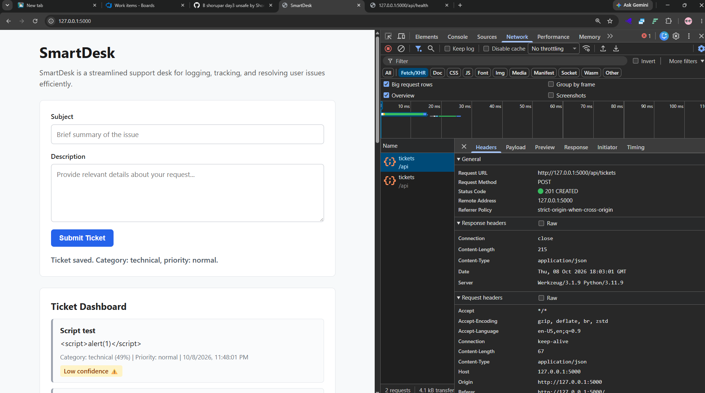 |
| TC-Image-003 | `{"subject":"Image test","description":""}` | 1. Enter Image test as Subject. 2. Enter `` as Description. 3. Click Submit Ticket. 4. Check the Ticket Dashboard. 5. Reload the dashboard and check the ticket again. | Status Code: 201 — The exact text `` is displayed as plain text. No image is rendered. | Status Code: 201 Created. The ticket was successfully created. The response stored the exact text ``, and no image was rendered on the dashboard. After reloading the dashboard, the exact text remained literal and no image was rendered. | PASS | 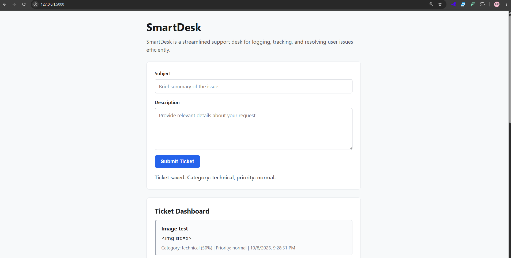 |
| TC-Spaces-004 | `{"subject":"Spaces test","description":" "}` | 1. Enter Spaces test as Subject. 2. Enter only spaces in Description. 3. Click Submit Ticket. 4. Verify the browser validation behavior in DevTools Network. 5. Send the same JSON through Postman to the API. | The spaces-only input is rejected. If browser validation prevents submission, no POST request is sent. The same JSON sent through the API should return an appropriate 400 response. | Clicking Submit with a single space as the description **did send** the POST. The description field carries `required`, and HTML `required` is satisfied by any non-empty string, including a space, so the browser did not block submission. Measured on 2026-10-12 in Chrome: the request went to `POST /api/tickets` and returned Status Code: 400 Bad Request with the response `"Description is required (max 500 characters)"`, the page displayed that message, and no ticket was created. The browser only blocks submission when a field is genuinely empty, which is a different behaviour and is not what this case tested. The same JSON sent through Postman returns the same 400. The expected behaviour above is met: the input is rejected, and the API returns the appropriate 400. | PASS | 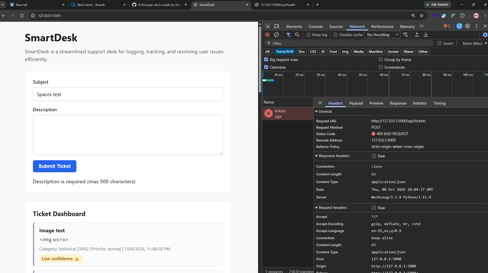 |

## Task 2933
> **Note on Model Accuracy & Pass Conditions:** General model accuracy is not evaluated as a strict Pass/Fail condition for standard API payload contract and priority checks. However, for Task 2933 end-to-end verification, ticket submission, refresh persistence, and AI classification outcomes are recorded and evaluated separately.
> **Task 2933 Audit & Verification Notes (Original vs. Updated)**
> 
> * **Model Accuracy Scope & Pass Conditions:**
>   * **What was previously recorded:** The original note stated broadly that model accuracy is not evaluated as a strict Pass/Fail condition for "any row here".
>   * **What was changed:** Corrected the blanket statement so that model accuracy exemption applies strictly to standard API payload contracts and priority checks. For Task 2933 end-to-end verification, submission success, refresh persistence, and AI classification outcomes are now evaluated and recorded as separate outcomes (e.g., `Classification Pass/Failed`, `Submission Pass`, `Reload Pass`).
> 
> * **Preservation of Exact Tested Inputs:**
>   * **What was previously recorded:** Recent edits cleaned up typos to `access issue` and modified description phrasing (e.g., `'I Can't access to my account anymore , after...'`).
>   * **What was changed:** Restored the exact, authentic submitted test inputs matching original captures and bug-log entries—including historical transcription variants—ensuring test data remains auditable rather than artificially polished.
> 
> * **Evidence Auditing & Transcription Verification:**
>   * **What was previously recorded:** Notes mentioned what screenshots supposedly show without explicit payload verification for retests.
>   * **What was changed:** Verified each evidence image against its corresponding test case. Added explicit notes explaining shared screenshots (e.g., Tickets #17 & #18 in `vaildaccessonpage.png`, Tickets #19 & #20 in `vaildbillingonpage.png`). For the retest (`TC-ValidAccessCheckedOnPage-02-Retest-01`), explicitly documented the verified JSON payload (`{"id": 24, "category": "billing", "confidence": 0.444, "priority": "normal"}`) directly supporting the outcome.
> 
> * **Session Attribution & Explicit Timestamps:**
>   * **What was previously recorded:** Dates were ambiguous or loosely formatted (e.g., `10/8/2026`).
>   * **What was changed:** Updated all session dates to unambiguous formats (`2026-10-08` and `2026-10-09`) with the recorded timezone (`EEST`). Explicitly attributed tested commit hash `880adfa49912bb0e213c11f63ddbf73cd7657cf4` to the 2026-10-09 retest session.
> 
> * **Documentation Cleanup & Git Workflow:**
>   * **What was changed:** Ensured all test files (`tests/test_cases.md` and `tests/bug_log.md`) have final newlines, verified Markdown table formatting, updated the Pull Request description to accurately reflect these audit additions, and confirmed clean staging (`git status` / `git diff --cached`) prior to pushing.

> *** Notes:** mentioned what screenshots supposedly show without explicit payload verification for retests, and contained a minor transcription copy error for Case 05 confidence (previously approximated as `0.64`)

>* **What was changed:** Verified each evidence image against its corresponding test case. For Case 05, explicitly corrected the confidence value to **`0.67`** to resolve a prior transcription copy error against the original evidence screenshot (`vaildbillingonpage.png`, Ticket #20). Added explicit notes explaining shared screenshots (e.g., Tickets #17 & #18 in `vaildaccessonpage.png`, Tickets #19 & #20 in `vaildbillingonpage.png`). For the retest (`TC-ValidAccessCheckedOnPage-02-Retest-01`), explicitly documented the verified JSON payload (`{"id": 24, "category": "billing", "confidence": 0.444, "priority": "normal"}`) directly supporting the outcome.

> TC-ValidAccessCheckedOnPage-01 &&  TC-ValidAccessCheckedOnPage-02: Updated the subject input from acess issue to access issue to correctly match the actual text entered

| Test ID | Input | Steps | Expected result | Actual result | Pass/Fail | Evidence |
| --- | --- | --- | --- | --- | --- | --- |
| TC-ValidAccessCheckedOnPage-01 | `{"subject":"access issue","description":"I Can't access to my account any more , after I enter the password many time"}` | 1. Go to tickets form 2. Enter your subject and description 3. click submit | create ticket successfully with the correct category "access" | The form submitted successfully. In DevTools Network, POST /api/tickets returned status HTTP 201 Created with generated ID 17 on 2026-10-08 19:48:03 EEST (exact commit hash was not recorded in original session metadata and remain explicitly unknown (subsequent documentation commits are intentionally not assigned)). The AI categorized it as access with 0.79 confidence and normal priority. After reloading the dashboard, ticket #17 remained visible with all data intact. Note: Evidence screenshot displays both Tickets #17 and #18 on the dashboard. | Classification Pass (Expected "access", Actual "access") Submission Pass Reload Pass | 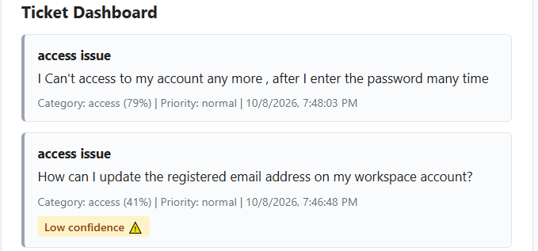 |
| TC-ValidAccessCheckedOnPage-02 | `{"subject":"access issue","description":"How can I update the registered email address on my workspace account?"}` | 1. Go to tickets form 2. Enter your subject and description 3. click submit | Create ticket successfully with the correct category "access" | The form submitted successfully. In DevTools Network, POST /api/tickets returned status HTTP 201 Created with generated ID 18 on 2026-10-08 19:46:48 EEST.(exact commit hash was not recorded in original session metadata and remain explicitly unknown (subsequent documentation commits are intentionally not assigned)) The AI categorized it as access with 0.41 confidence and normal priority. After reloading the dashboard, ticket #18 remained visible with all data intact. Note: Evidence screenshot displays both Tickets #17 and #18 on the dashboard, Priority is recorded as 'normal'. | Classification Pass (Expected "access", Actual "access") Submission Pass Reload Pass |  |
| TC-ValidAccessCheckedOnPage-02-Retest-01 | `{"subject":"accesss issue","description":"How can I update the registered email address on my workspace account?"}` | 1. go to tickets form 2. Enter your subject and description 3. click submit | create ticket successfully with the correct category "access" | The form submitted successfully. In DevTools Network, POST /api/tickets returned HTTP 201 Created with generated ID 24. Retested on commit `880adfa49912bb0e213c11f63ddbf73cd7657cf4` on 2026-10-09 18:51:00 EEST.( remain explicitly unknown (subsequent documentation commits are intentionally not assigned)) The AI categorized it as billing with 0.444 confidence and normal priority. After reloading the dashboard, ticket #24 remained visible with all data intact. Note: Attached evidence screenshot displays the complete JSON response payload confirming ID 24, category 'billing', confidence 0.444, and priority 'normal'. | Classification Failed (Expected "access", Actual "billing") Submission Pass Reload Pass | 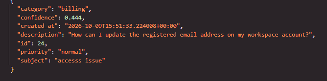 |
| TC-501CharacterDescription-03 | generated-input: subject: "Technical support request"; description: 'y' repeated 501 times (generated via python -c "print('y'*501)") | 1. go to tickets form 2. Enter your subject and description of 501 characters | Frontend restricts input to maximum 500 characters | Tested input with 501 'y' characters on 2026-10-08. The frontend textarea automatically limited and retained exactly 500 characters (verified via document.querySelector('textarea').value.length). The extra character was truncated by the browser input restriction without an error alert. Classified as a usability observation rather than a confirmed bug. (exact commit hash was not recorded in original session metadata and remain explicitly unknown (subsequent documentation commits are intentionally not assigned))Note: Attached evidence displays the Browser Console verification confirming the input text length is strictly capped at 500 characters. | Pass | 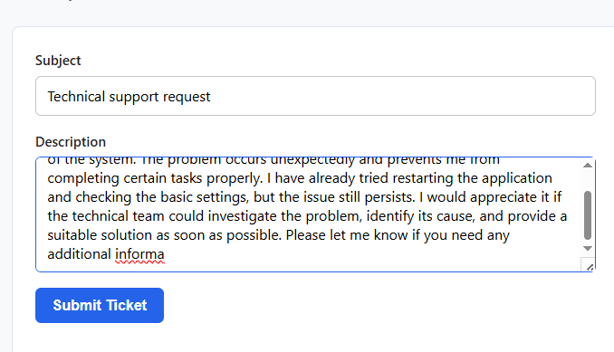 |
| TC-ValidbillingCheckedOnPage-04 | `{"subject":"billing support request","description":"The amount charged on my latest statement is higher than the price I was shown"}` | 1. Go to tickets form 2. Enter your subject and description 3. Click Submit | create ticket successfully with the correct category "billing" | The form submitted successfully. In DevTools Network, POST /api/tickets returned status HTTP 201 Created with generated ID 19 on 2026-10-08 19:50:33 EEST.(exact commit hash was not recorded in original session metadata and remain explicitly unknown (subsequent documentation commits are intentionally not assigned)) The AI categorized it as billing with 0.66 confidence and normal priority. After reloading the dashboard, ticket #19 remained visible with all data intact. Note: Evidence screenshot displays both Tickets #19 and #20 on the dashboard. | Classification Pass (Expected "billing", Actual "billing") Submission Pass Reload Pass | 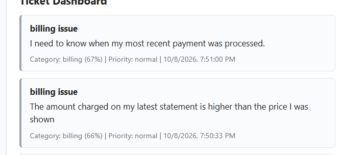 |
| TC-ValidbillingCheckedOnPage-05 | `{"subject":"billing support request","description":"I need to know when my most recent payment was processed"}` | 1. Go to tickets form 2. Enter your subject and description 3. Click Submit | create ticket successfully with the correct category "billing" | The form submitted successfully. In DevTools Network, POST /api/tickets returned status HTTP 201 Created with generated ID 20 on 2026-10-08 19:51:00 EEST. (exact commit hash was not recorded in original session metadata and remain explicitly unknown (subsequent documentation commits are intentionally not assigned))The AI categorized it as billing with 0.67 confidence and normal priority. After reloading the dashboard, ticket #20 remained visible with all data intact. Note: Evidence screenshot displays both Tickets #19 and #20 on the dashboard. | Classification Pass (Expected "billing", Actual "billing") Submission Pass Reload Pass |  |
| TC-501CharacterServerValidation-06 | `subject: "Technical support request" description: 'y' repeated 501 times (generated via python -c "print('y'*501)")` | 1. Open Postman 2. Set POST http://127.0.0.1:5000/api/tickets request and set Headers to Content-Type: application/json 3. Navigate to Body > raw > JSON and input the payload with a description repeating the character 'y' exactly 501 times and your subject 4. click send and observe the response status and error message | Server rejects request with HTTP 400 and description validation error | Server returned HTTP 400 Bad Request with response: `{"error": "Description is required (max 500 characters)"}` on 2026-10-08.(exact commit hash was not recorded in original session metadata.) Note: Attached evidence shows Postman UI with HTTP 400 response body. | Pass | 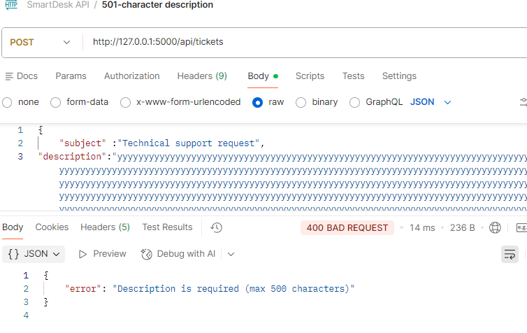 |

### Task 2933 — Thato's Browser E2E Contribution

| Test ID | Input | Steps | Expected result | Actual result | Pass/Fail | Evidence |
|---|---|---|---|---|---|---|
| TC-2933-Thato-ValidTechnical-01 | `{"subject":"PDF upload failed","description":"The app freezes when I upload a PDF"}` | Submit the technical ticket through the browser. Check the displayed ticket, inspect the API record, and refresh the dashboard. | The ticket is submitted with the correct `technical` category, the entered subject and description are stored correctly, and the ticket remains visible after refresh. | The dashboard displayed **PDF upload failed** with the description **The app freezes when I upload a PDF**. The category was `technical (66%)` and the priority was `normal`. The API response was checked during testing and reportedly contained matching ticket details, but it was not saved as evidence. The ticket was reported to remain visible after refresh. | Displayed ticket and classification: Pass (observed); API matching and reload persistence: observed, but not independently evidenced as the response was not recorded. | 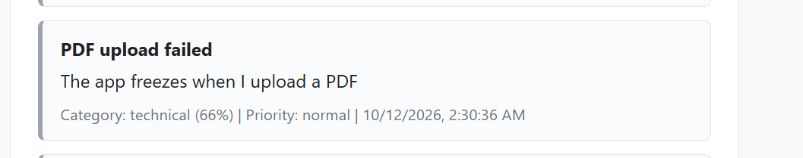 |
| TC-2933-Thato-BlankSubject-02 | `{"subject":"","description":"Need help with my account settings"}` | Leave the subject field empty, enter the description, and attempt to submit through the browser. Separately, inspect the direct API response. | The browser prevents submission when the subject is empty. A direct API request with an empty subject returns HTTP `400` with a subject-required error. | The browser form did not allow submission when the subject field was empty. Whether the browser sent a POST request was not recorded. Separately, the direct API request returned HTTP `400 Bad Request` with `{"error":"Subject is required (max 100 characters)"}`. | Browser validation: Observed; browser Network activity: Not recorded; direct API rejection: Pass. | 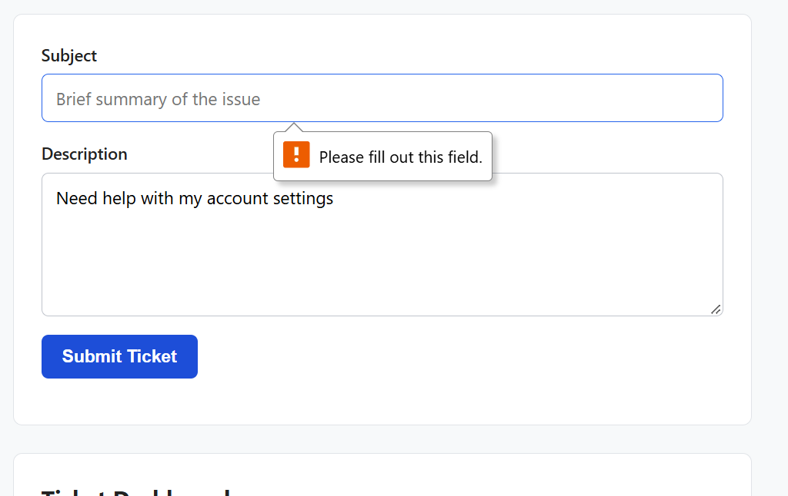; 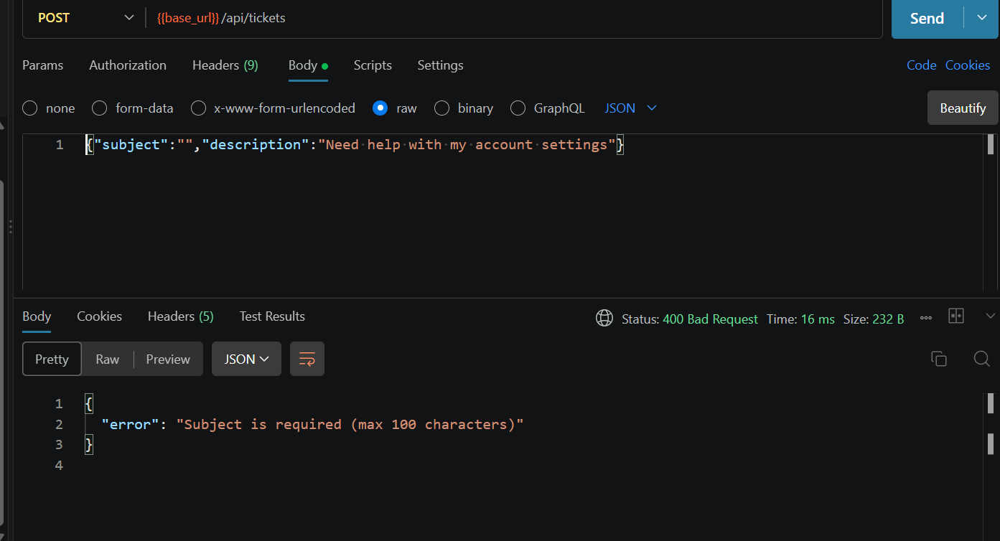 |
| TC-2933-Thato-DuplicateTicket-03 | Submit the same subject and description twice; exact values are not recorded in the available evidence. | Submit the same ticket twice. Record both POST statuses and IDs, inspect `/api/tickets` for both stored records, and refresh the dashboard without clearing the database. | Determine whether both submissions are accepted, whether each has a distinct ID, and whether both stored tickets remain visible after refresh. | Two submissions were reported as separate tickets, and both were reported visible on the dashboard after refresh. The exact submitted text, HTTP statuses, ticket IDs, matching GET `/api/tickets` records, and independently evidenced persistence are not available in the retained evidence. | Incomplete — insufficient evidence to independently confirm both submissions, distinct IDs, matching API records, and persistence after refresh. | 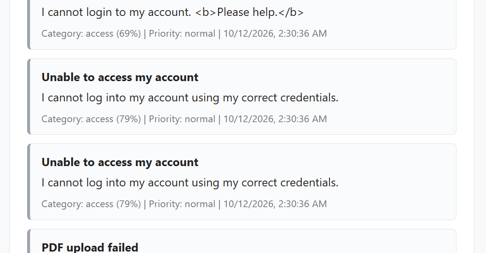 |

**Failure tracking:** No application bug raised; the currently retained evidence does not establish a genuine application failure.
